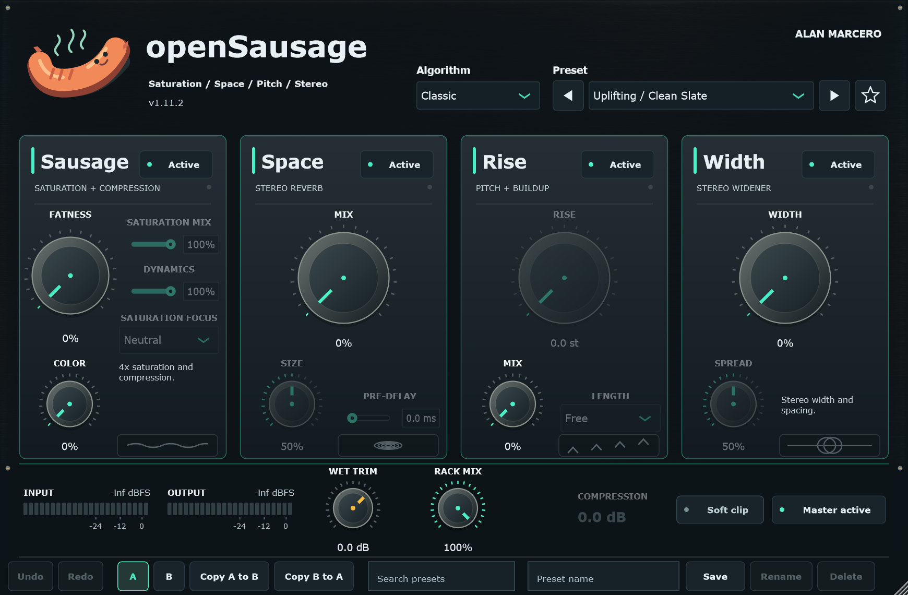

# openSausage

A four-part effect plugin for adding saturation, reverb, rising pitch, and stereo width to a track or bus.

[Download the latest release](https://github.com/alanmarcero/openSausage/releases/latest) · [Install with OpenVST Manager](https://github.com/alanmarcero/alan-m-OpenVSTManager/releases/latest)

## Effects

The sections run in this order: Sausage, Space, Rise, and Width.

- **Sausage:** Fatness and Color adjust saturation. Mix blends clean and saturated audio. Dynamics controls compression. Neutral Focus saturates all frequencies. Keep Low protects bass; Keep High keeps treble cleaner.
- **Space:** Mix controls stereo reverb amount. Size changes decay.
- **Rise:** Shift pitch upward by up to one octave. Mix sets the effect level. Automate Rise for a pitch build.
- **Width:** Widen stereo audio or create stereo from mono. Spread changes stereo spacing.

Each section has its own bypass. Master bypass skips the full chain and output trim. Output trim ranges from −24 to +12 dB; the output meter helps you set levels. The plugin does not limit peaks automatically.

Choose one global style: Classic, Velvet, Punch, or Prism. It changes all four effects while keeping knob settings. Factory recipes provide 48 style-organized starting points across seven dance genres (12 in Uplifting plus 6 each in Rolling, Progressive, Psy, Tech, Bass & Breaks, and Classic). The DAW program list shows those same 48 recipes, in that order.

Rise Length can stay Free, which holds the pitch you set, or sweep from unison up to the Rise knob over 1, 2, 4, 8, or 16 bars locked to the host tempo. Standalone keeps using its 120 BPM clock.

DAW sessions recall settings, including both A and B slots. Controls and bypass switches support automation. Undo and Redo step through control changes from the buttons or from Cmd/Ctrl+Z and Shift+Cmd/Ctrl+Z. A knob drag or a recipe load is one step. A and B keep two copies of the sound; copy either way and switch. Saved presets go in Documents/Alan Marcero/openSausage/Presets. Search lists the factory recipes and your saved presets, and stars bring favorites to the top. Factory recipes stay read-only. The grilled sausage illustration rocks on the host beat and follows tempo changes and seeks. It rests when the host stops. Standalone uses an internal 120 BPM clock. The four effect displays follow the same clock. Drag a knob to adjust it, double-click to reset it, click its value to type, or hover for help. Resize the editor from its corner.

The plugin supports mono and stereo audio. Width needs a stereo output, and its added width disappears when summed to mono. Reported latency stays fixed at 16 samples.

## Formats

- **macOS 11 or newer:** Universal VST3, Audio Unit (AU), and standalone app.
- **Windows x64:** VST3 and standalone app.

Use [OpenVST Manager](https://github.com/alanmarcero/alan-m-OpenVSTManager/releases/latest) or download a package from the [latest release](https://github.com/alanmarcero/openSausage/releases/latest).

## License

MIT. See [LICENSE](LICENSE) and [third-party notices](THIRD_PARTY.md).
