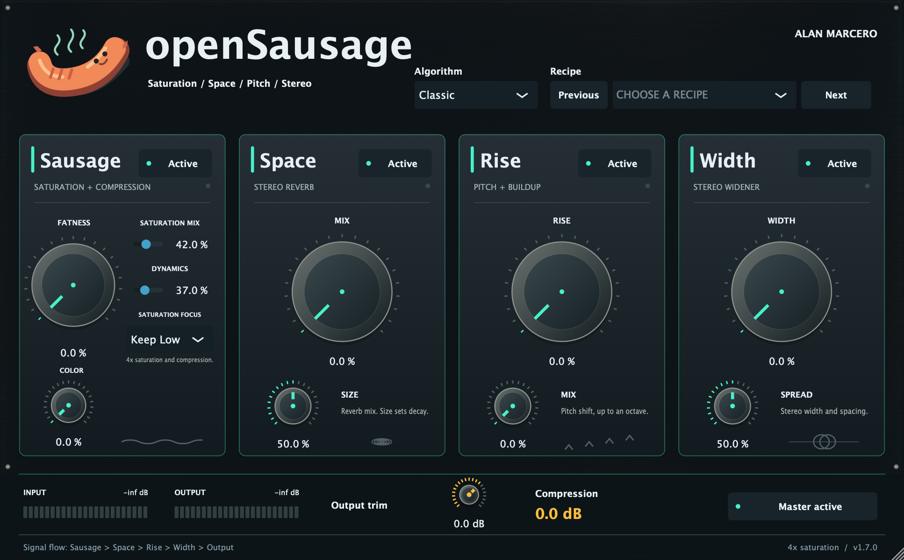

# Native UI screenshot



`assets/native-ui.png` is a fresh macOS capture from the current Release build's native JUCE editor using `sausage_editor_capture`. The header shows the bundled SVG illustration. Its position and rotation follow the transport beat, including a held negative PPQ seek verified in the harness. Captures are JUCE component snapshots at 1.5× scale.

The harness exercises all four algorithm choices, their actual audio output, host automation, recipe defaults, legacy/current state recall, saturation controls, bypass controls, and resizing before completing successfully. It writes one image for each algorithm plus clean, maximum-Fatness, buildup, bypassed, and compact states under `docs/screenshots/`.

```sh
cmake --build build --config Release --target sausage_editor_capture --parallel
build/sausage_editor_capture_artefacts/Release/sausage_editor_capture docs/screenshots
```

The main `assets/native-ui.png` image is copied from the harness's clean capture after verification. These screenshots show the actual editor and current controls; no vendor UI or artwork is used.
