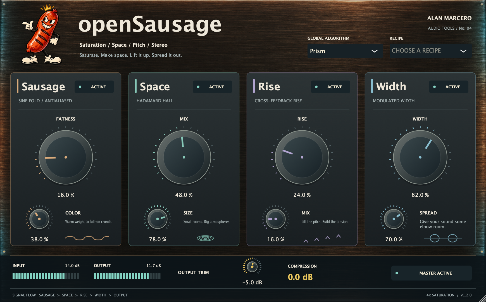

# Native UI screenshot



`assets/native-ui.png` was captured on macOS on 2026-10-27 from the compiled **v1.2.0 native JUCE editor** using `sausage_editor_capture`. It shows the **Prism** global algorithm with the **In orbit** recipe while processing a stereo test signal at 48 kHz. The image is a JUCE component snapshot at 1.5× scale (1740 × 1080); it is not a UI mockup or a capture of a published release archive.

The harness exercises all four algorithm choices, their actual audio output, host automation, recipes, legacy/current state recall, bypass controls, and resizing before completing successfully. It writes one image for each algorithm plus clean, maximum-Fatness, buildup, bypassed, and compact states under `build/algorithm-screenshots/`.

```sh
cmake --build build --target sausage_editor_capture --parallel
build/sausage_editor_capture_artefacts/Release/sausage_editor_capture build/algorithm-screenshots
```

Screenshot SHA-256: `3b3cab8543ca2e0205b15e3f1a8228d02aa8c90401f481e5fadb042514857973`.
